# Event Management MVP - System Architecture Documentation

## Table of Contents
1. [System Overview](#system-overview)
2. [High-Level Architecture](#high-level-architecture)
3. [Component Architecture](#component-architecture)
4. [Data Architecture](#data-architecture)
5. [Security Architecture](#security-architecture)
6. [Deployment Architecture](#deployment-architecture)
7. [API Architecture](#api-architecture)
8. [Background Processing](#background-processing)
9. [Scalability & Performance](#scalability--performance)
10. [Disaster Recovery](#disaster-recovery)

---

## System Overview

### Business Context

Event Management MVP is a production-grade backend platform enabling:
- **Event Organizers**: Create, manage, and monetize events
- **Attendees**: Discover, book, and attend events
- **Administrators**: Oversee platform operations

### Technical Stack Summary

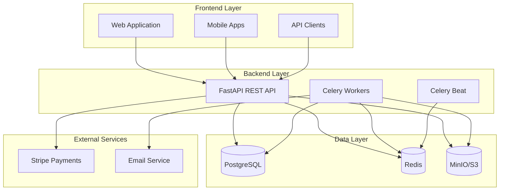

---

## High-Level Architecture

### System Context Diagram

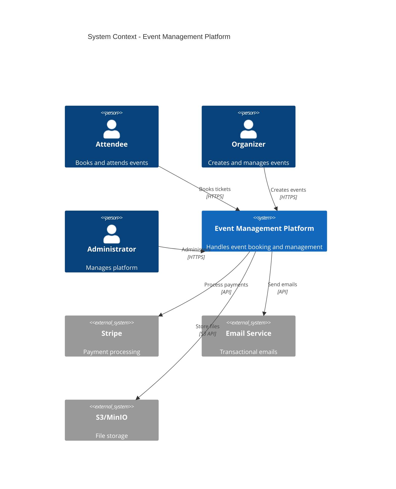

### Container Diagram

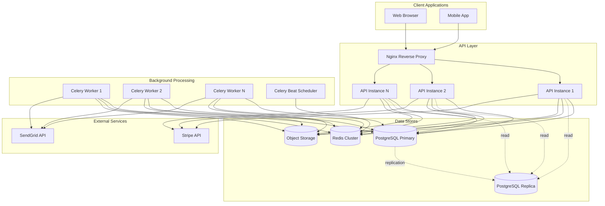

---

## Component Architecture

### Layered Architecture

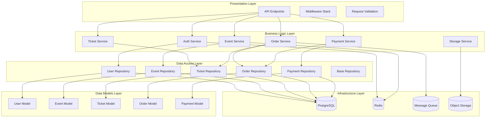

### Request Processing Flow

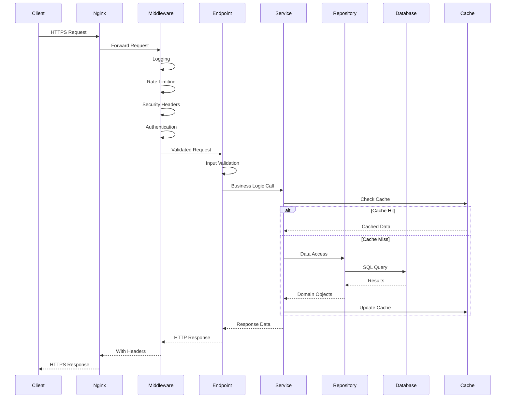

---

## Data Architecture

### Database Schema (ER Diagram)

```mermaid
erDiagram
    USERS ||--o{ EVENTS : "organizes"
    USERS ||--o{ ORDERS : "places"
    CATEGORIES ||--o{ EVENTS : "categorizes"
    EVENTS ||--o{ TICKETS : "has"
    EVENTS ||--o{ ORDERS : "for"
    TICKETS ||--o{ ORDER_ITEMS : "contains"
    ORDERS ||--o{ ORDER_ITEMS : "includes"
    ORDERS ||--|| PAYMENTS : "pays"
    
    USERS {
        uuid id PK
        varchar email UK "Unique identifier"
        varchar hashed_password
        varchar first_name
        varchar last_name
        enum role "attendee|organizer|admin"
        varchar avatar_url
        boolean is_active
        boolean is_verified
        timestamp created_at
        timestamp updated_at
    }
    
    CATEGORIES {
        uuid id PK
        varchar name UK
        varchar slug UK "URL-safe identifier"
        text description
        varchar icon "Emoji icon"
        boolean is_active
        timestamp created_at
        timestamp updated_at
    }
    
    EVENTS {
        uuid id PK
        varchar title
        text description
        varchar slug UK
        uuid category_id FK
        uuid organizer_id FK
        timestamp start_datetime "With timezone"
        timestamp end_datetime
        varchar timezone "IANA timezone"
        varchar venue_name
        varchar venue_address
        varchar venue_city
        varchar venue_state
        varchar venue_country
        float latitude
        float longitude
        varchar banner_url
        int total_capacity
        int available_capacity
        enum status "draft|published|cancelled|completed"
        boolean is_featured
        timestamp published_at
        timestamp created_at
        timestamp updated_at
    }
    
    TICKETS {
        uuid id PK
        uuid event_id FK
        varchar name "Ticket type name"
        text description
        decimal price "With 2 decimals"
        int quantity_total
        int quantity_available "Real-time inventory"
        int min_per_order
        int max_per_order
        timestamp sale_start_date
        timestamp sale_end_date
        timestamp created_at
        timestamp updated_at
    }
    
    ORDERS {
        uuid id PK
        varchar order_number UK "Human-readable"
        uuid user_id FK
        uuid event_id FK
        decimal total_amount
        enum status "pending|confirmed|cancelled|refunded|expired"
        enum payment_status "pending|succeeded|failed|refunded"
        timestamp created_at
        timestamp updated_at
    }
    
    ORDER_ITEMS {
        uuid id PK
        uuid order_id FK
        uuid ticket_id FK
        int quantity
        decimal unit_price "Snapshot at purchase"
        decimal subtotal
        timestamp created_at
    }
    
    PAYMENTS {
        uuid id PK
        uuid order_id FK UK
        varchar stripe_payment_intent_id UK
        decimal amount
        varchar currency "ISO code"
        enum status "pending|succeeded|failed|refunded"
        varchar payment_method "card|bank_transfer"
        timestamp created_at
        timestamp updated_at
    }
```

### Data Flow - Order Creation

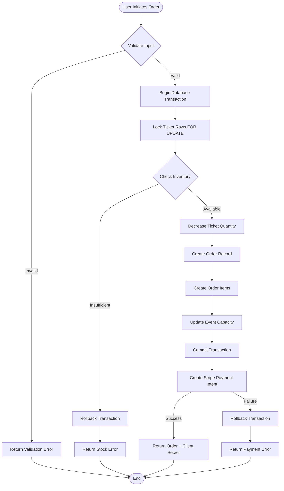

### Caching Strategy

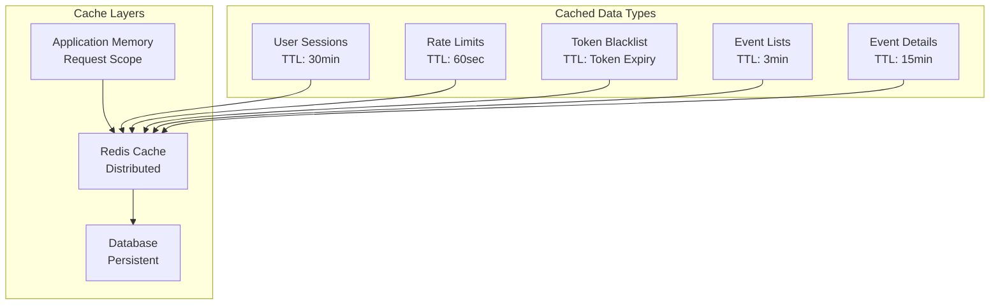

---

## Security Architecture

### Authentication Flow

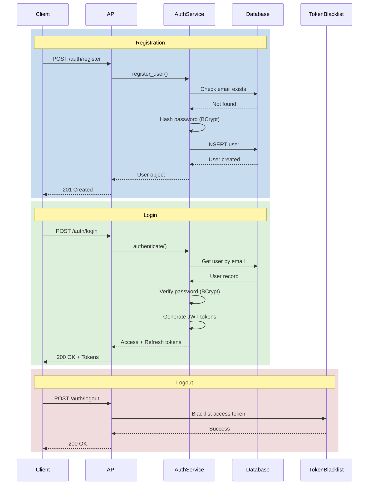

### Authorization Model

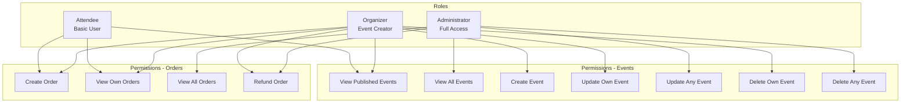

### Security Layers

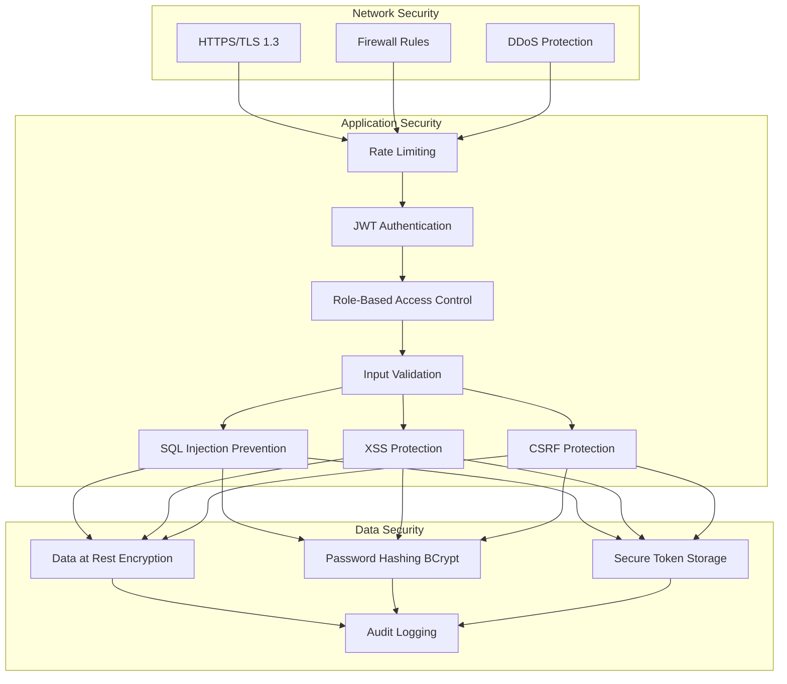

---

## Deployment Architecture

### Production Deployment

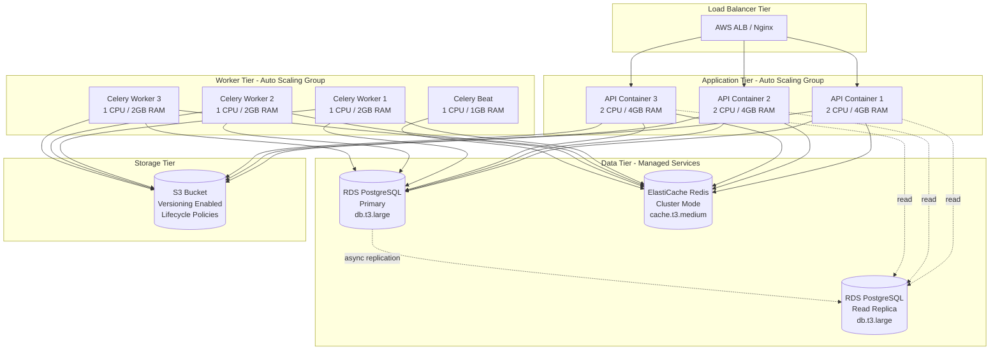

### Kubernetes Deployment

```yaml
# Shown in diagram form
```

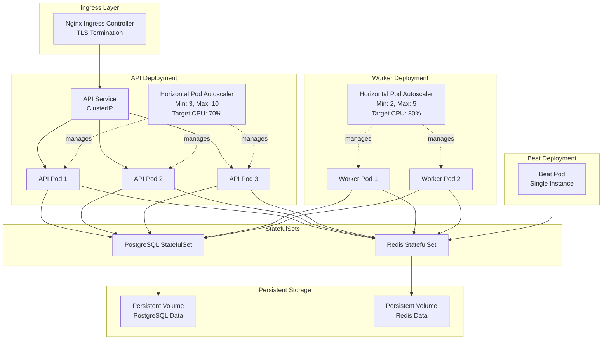

---

## API Architecture

### RESTful API Design

```mermaid
graph LR
    subgraph "API Versioning"
        V1[/api/v1/]
        V2[/api/v2/ - Future]
    end
    
    subgraph "Resource Endpoints"
        AUTH[/auth]
        USERS[/users]
        EVENTS[/events]
        TICKETS[/tickets]
        ORDERS[/orders]
        PAYMENTS[/payments]
        CATEGORIES[/categories]
    end
    
    V1 --> AUTH & USERS & EVENTS & TICKETS & ORDERS & PAYMENTS & CATEGORIES
    
    AUTH --> AUTH_REGISTER[POST /register]
    AUTH --> AUTH_LOGIN[POST /login]
    AUTH --> AUTH_REFRESH[POST /refresh]
    AUTH --> AUTH_LOGOUT[POST /logout]
    
    EVENTS --> EVENTS_LIST[GET /events]
    EVENTS --> EVENTS_CREATE[POST /events]
    EVENTS --> EVENTS_DETAIL[GET /events/:id]
    EVENTS --> EVENTS_UPDATE[PUT /events/:id]
    EVENTS --> EVENTS_DELETE[DELETE /events/:id]
    EVENTS --> EVENTS_PUBLISH[PATCH /events/:id/publish]
    
    ORDERS --> ORDERS_CREATE[POST /orders]
    ORDERS --> ORDERS_LIST[GET /orders]
    ORDERS --> ORDERS_DETAIL[GET /orders/:id]
    ORDERS --> ORDERS_CANCEL[POST /orders/:id/cancel]
```

### API Response Patterns

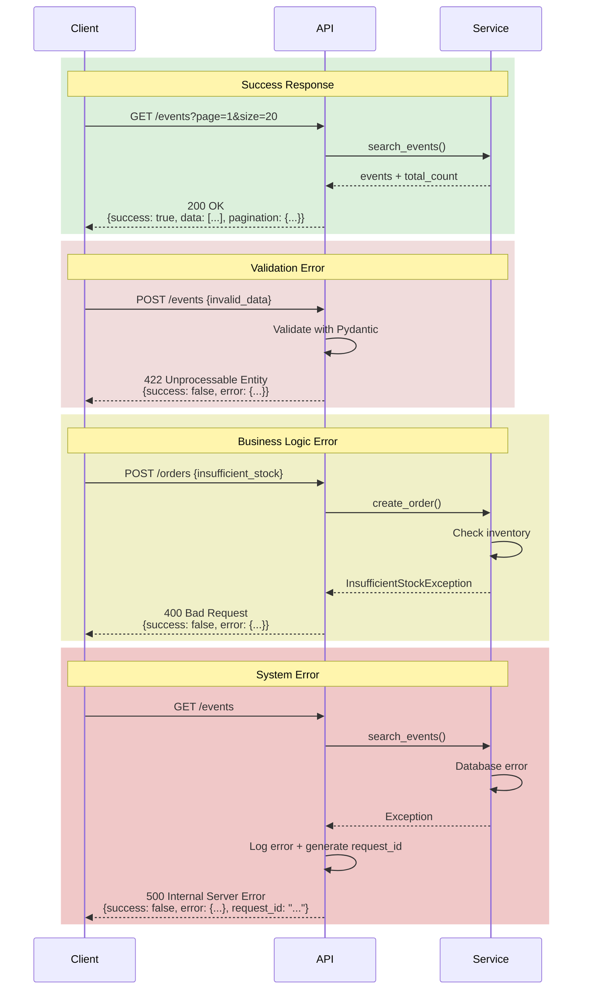

---

## Background Processing

### Celery Task Architecture

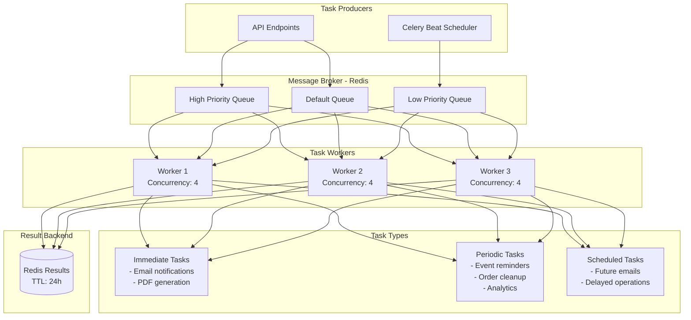

### Task Flow - Ticket Generation

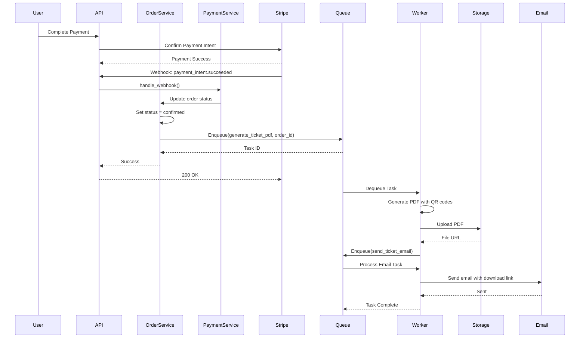

### Periodic Tasks Schedule

```mermaid
gantt
    title Celery Beat Scheduled Tasks
    dateFormat HH:mm
    axisFormat %H:%M
    
    section Daily Tasks
    Event Reminders (9 AM)           :crit, 09:00, 10m
    Analytics Update (2 AM)          :active, 02:00, 30m
    
    section Hourly Tasks
    Order Cleanup (Every hour)       :milestone, 00:00, 0h
    Cache Warming (Every 2h)         :01:00, 10m
    
    section Every 30 Minutes
    Expired Orders Check             :milestone, 00:00, 0h
    Pending Payments Check           :milestone, 00:00, 0h
```

---

## Scalability & Performance

### Horizontal Scaling Strategy

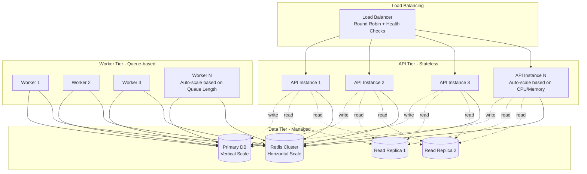

### Performance Optimization Layers

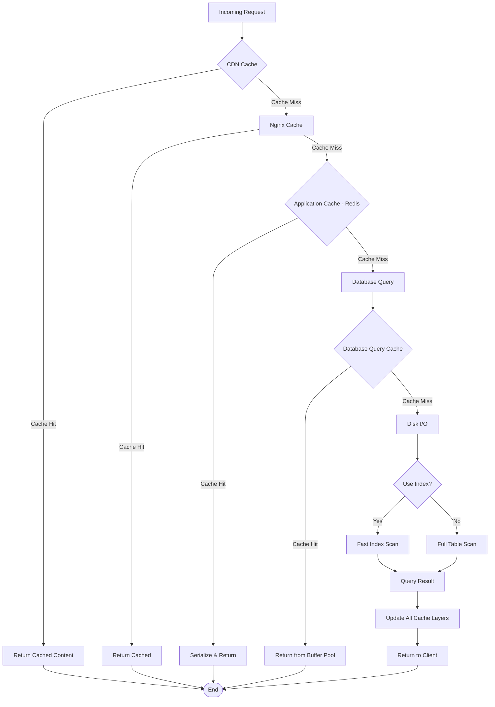

### Database Performance Tuning

```mermaid
graph LR
    subgraph "Query Optimization"
        INDEXES[Strategic Indexes]
        QUERY_PLAN[Query Plan Analysis]
        EXPLAIN[EXPLAIN ANALYZE]
    end
    
    subgraph "Connection Management"
        POOL[Connection Pooling<br/>Size: 50<br/>Overflow: 100]
        TIMEOUT[Connection Timeout: 30s]
        KEEPALIVE[Keep-Alive: Enabled]
    end
    
    subgraph "Data Access Patterns"
        EAGER[Eager Loading<br/>Prevent N+1]
        PAGINATION[Cursor Pagination]
        READONLY[Read-Only Replicas]
    end
    
    subgraph "Maintenance"
        VACUUM[Auto Vacuum]
        ANALYZE[Auto Analyze]
        REINDEX[Scheduled Reindexing]
    end
    
    INDEXES & QUERY_PLAN & EXPLAIN --> POOL
    POOL & TIMEOUT & KEEPALIVE --> EAGER
    EAGER & PAGINATION & READONLY --> VACUUM
```

---

## Disaster Recovery

### Backup Strategy

```mermaid
graph TB
    subgraph "Backup Sources"
        POSTGRES[(PostgreSQL<br/>Primary)]
        REDIS[(Redis<br/>AOF + RDB)]
        S3[(S3 Bucket<br/>Files)]
    end
    
    subgraph "Backup Schedule"
        FULL[Full Backup<br/>Daily 2 AM]
        INCREMENTAL[Incremental Backup<br/>Every 6 hours]
        CONTINUOUS[Continuous WAL Archiving<br/>Real-time]
    end
    
    subgraph "Backup Storage"
        S3_BACKUP[(S3 Backup Bucket<br/>Versioning Enabled<br/>Lifecycle: 90 days)]
        GLACIER[(Glacier<br/>Long-term Archive<br/>7 years)]
    end
    
    subgraph "Recovery Procedures"
        PITR[Point-in-Time Recovery<br/>Up to 35 days]
        SNAPSHOT[Snapshot Restore<br/>Within 30 minutes]
        FULL_RESTORE[Full System Restore<br/>Within 4 hours]
    end
    
    POSTGRES --> FULL & INCREMENTAL & CONTINUOUS
    REDIS --> FULL
    S3 --> FULL
    
    FULL & INCREMENTAL & CONTINUOUS --> S3_BACKUP
    S3_BACKUP -.after 30 days.-> GLACIER
    
    S3_BACKUP --> PITR & SNAPSHOT & FULL_RESTORE
```

### High Availability Architecture

```mermaid
graph TB
    subgraph "Region 1 - Primary"
        AZ1A[Availability Zone A]
        AZ1B[Availability Zone B]
        
        subgraph "AZ1A Components"
            API1A[API Instances]
            DB1A[(DB Primary)]
        end
        
        subgraph "AZ1B Components"
            API1B[API Instances]
            DB1B[(DB Standby)]
        end
    end
    
    subgraph "Region 2 - DR"
        AZ2A[Availability Zone A]
        
        subgraph "AZ2A Components"
            API2A[API Instances<br/>Cold Standby]
            DB2A[(DB Replica<br/>Async Replication)]
        end
    end
    
    USERS[Users] --> LB1[Load Balancer<br/>Health Checks]
    LB1 --> API1A & API1B
    
    API1A & API1B --> DB1A
    DB1A -.sync replication.-> DB1B
    DB1A -.async replication.-> DB2A
    
    DB1A -.failover.-> DB1B
    
    LB1 -.disaster failover.-> API2A
    API2A -.-> DB2A
```

### Incident Response Flow

```mermaid
graph TD
    START([Incident Detected]) --> ALERT{Alert Type}
    
    ALERT -->|Critical| PAGE[Page On-Call Engineer]
    ALERT -->|Warning| LOG[Log to Monitoring]
    ALERT -->|Info| NOTIFY[Team Notification]
    
    PAGE --> ASSESS[Assess Impact]
    ASSESS --> SEVERITY{Severity Level}
    
    SEVERITY -->|P0 - System Down| IMMEDIATE[Immediate Response<br/>Activate DR Plan]
    SEVERITY -->|P1 - Degraded| URGENT[Urgent Fix<br/>< 1 hour]
    SEVERITY -->|P2 - Minor Issue| SCHEDULED[Schedule Fix<br/>< 24 hours]
    
    IMMEDIATE --> FAILOVER{Failover Required?}
    FAILOVER -->|Yes| EXECUTE_DR[Execute DR Procedures]
    FAILOVER -->|No| HOTFIX[Deploy Hotfix]
    
    URGENT --> HOTFIX
    
    EXECUTE_DR --> VERIFY[Verify System Health]
    HOTFIX --> VERIFY
    SCHEDULED --> VERIFY
    
    VERIFY --> POSTMORTEM[Post-Incident Review]
    POSTMORTEM --> DOCUMENT[Document Lessons Learned]
    DOCUMENT --> END([Incident Closed])
    
    LOG --> MONITOR[Continue Monitoring]
    NOTIFY --> MONITOR
    MONITOR --> END
```

---

## Monitoring & Observability

### Monitoring Architecture

```mermaid
graph TB
    subgraph "Application Layer"
        API[API Services]
        WORKERS[Celery Workers]
    end
    
    subgraph "Metrics Collection"
        PROMETHEUS[Prometheus<br/>Time-series DB]
        STATSD[StatsD<br/>Metrics Aggregation]
    end
    
    subgraph "Logging"
        LOGURU[Loguru Logger]
        ELASTICSEARCH[Elasticsearch<br/>Log Storage]
        KIBANA[Kibana<br/>Log Visualization]
    end
    
    subgraph "Tracing"
        JAEGER[Jaeger<br/>Distributed Tracing]
    end
    
    subgraph "Alerting"
        ALERTMANAGER[Alert Manager]
        PAGERDUTY[PagerDuty]
        SLACK[Slack Notifications]
    end
    
    subgraph "Dashboards"
        GRAFANA[Grafana<br/>Metrics Dashboards]
        CUSTOM[Custom Admin Dashboard]
    end
    
    API & WORKERS --> LOGURU
    API & WORKERS --> STATSD
    API & WORKERS --> JAEGER
    
    LOGURU --> ELASTICSEARCH
    ELASTICSEARCH --> KIBANA
    
    STATSD --> PROMETHEUS
    PROMETHEUS --> GRAFANA
    PROMETHEUS --> ALERTMANAGER
    
    ALERTMANAGER --> PAGERDUTY & SLACK
    
    GRAFANA --> CUSTOM
```

### Key Performance Indicators

```mermaid
graph LR
    subgraph "Application Metrics"
        REQ_RATE[Request Rate<br/>Target: 1000 req/s]
        LATENCY[P95 Latency<br/>Target: < 200ms]
        ERROR_RATE[Error Rate<br/>Target: < 1%]
    end
    
    subgraph "Business Metrics"
        ORDERS[Orders/Hour<br/>Track Trends]
        REVENUE[Revenue/Day<br/>Real-time]
        CONVERSION[Conversion Rate<br/>Track Funnel]
    end
    
    subgraph "Infrastructure Metrics"
        CPU[CPU Usage<br/>Target: < 70%]
        MEMORY[Memory Usage<br/>Target: < 80%]
        DISK[Disk I/O<br/>Monitor IOPS]
    end
    
    subgraph "Database Metrics"
        CONN[Active Connections<br/>Monitor Pool]
        QUERY_TIME[Query Time<br/>P95 < 50ms]
        REPLICATION[Replication Lag<br/>Target: < 1s]
    end
```

---

## Security Compliance

### OWASP Top 10 Mitigation

```mermaid
graph TB
    A1[A1: Injection] --> SOL1[Parameterized Queries<br/>SQLAlchemy ORM<br/>Input Validation]
    A2[A2: Broken Auth] --> SOL2[JWT with Expiry<br/>BCrypt Hashing<br/>MFA Support]
    A3[A3: Sensitive Data] --> SOL3[TLS Encryption<br/>Password Hashing<br/>Secrets Management]
    A4[A4: XML External Entities] --> SOL4[JSON Only<br/>No XML Processing]
    A5[A5: Broken Access Control] --> SOL5[RBAC<br/>Ownership Checks<br/>Resource-level Authorization]
    A6[A6: Security Misconfiguration] --> SOL6[Hardened Defaults<br/>Security Headers<br/>Minimal Attack Surface]
    A7[A7: XSS] --> SOL7[Output Encoding<br/>Content Security Policy<br/>Input Sanitization]
    A8[A8: Insecure Deserialization] --> SOL8[Type-safe Pydantic<br/>No eval()<br/>Trusted Sources Only]
    A9[A9: Using Components with Known Vulnerabilities] --> SOL9[Dependency Scanning<br/>Regular Updates<br/>Bandit Security Checks]
    A10[A10: Insufficient Logging] --> SOL10[Comprehensive Logging<br/>Audit Trails<br/>Security Event Monitoring]
```

### Data Protection Flow

```mermaid
graph LR
    subgraph "Data at Rest"
        DB_ENCRYPT[Database Encryption<br/>AES-256]
        FILE_ENCRYPT[File Encryption<br/>Server-side S3]
        BACKUP_ENCRYPT[Backup Encryption<br/>GPG]
    end
    
    subgraph "Data in Transit"
        TLS[TLS 1.3<br/>Strong Ciphers]
        CERT[SSL Certificates<br/>Auto-renewal]
        HSTS[HSTS Enabled<br/>Preload List]
    end
    
    subgraph "Data in Use"
        MEMORY_SAFE[Memory-safe Operations]
        TEMP_CLEAN[Temp Data Cleanup]
        NO_LOG_PII[No PII in Logs]
    end
    
    subgraph "Access Control"
        RBAC_DATA[Role-based Access]
        FIELD_ENCRYPT[Field-level Encryption<br/>PII Fields]
        AUDIT[Audit Logging<br/>Who/What/When]
    end
    
    DB_ENCRYPT & FILE_ENCRYPT & BACKUP_ENCRYPT --> TLS
    TLS & CERT & HSTS --> MEMORY_SAFE
    MEMORY_SAFE & TEMP_CLEAN & NO_LOG_PII --> RBAC_DATA
    RBAC_DATA & FIELD_ENCRYPT & AUDIT --> COMPLIANT[GDPR/CCPA Compliant]
```

---

## Technology Decision Matrix

### Framework Selection

| Technology | Why Chosen | Alternatives Considered |
|------------|------------|------------------------|
| **FastAPI** | High performance, async support, auto-docs | Django REST, Flask |
| **PostgreSQL** | ACID compliance, JSON support, reliability | MySQL, MongoDB |
| **Redis** | In-memory speed, pub/sub, atomic operations | Memcached, Hazelcast |
| **Celery** | Mature, distributed, flexible routing | RQ, Dramatiq |
| **SQLAlchemy** | ORM maturity, async support, type safety | Django ORM, Raw SQL |
| **Pydantic** | Data validation, performance, type hints | Marshmallow, Cerberus |
| **Docker** | Portability, consistency, ecosystem | Podman, Native |
| **Stripe** | Developer experience, global support, features | PayPal, Square |

---

## Future Enhancements

### Roadmap Architecture Evolution

```mermaid
timeline
    title Architecture Evolution Roadmap
    section Phase 1 (Current)
        Monolithic Backend : FastAPI Monolith
                           : Single Database
                           : Basic Caching
    
    section Phase 2 (Q1 2025)
        Enhanced Features : WebSocket Support
                         : Elasticsearch Integration
                         : Advanced Analytics
                         : Email Service Integration
    
    section Phase 3 (Q2 2025)
        Microservices Prep : Service Boundaries Defined
                          : API Gateway
                          : Service Mesh (Istio)
                          : Event-driven Architecture
    
    section Phase 4 (Q3 2025)
        Microservices : Event Service
                     : Payment Service
                     : Notification Service
                     : User Service
    
    section Phase 5 (Q4 2025)
        Global Scale : Multi-region Deployment
                    : CDN Integration
                    : GraphQL API
                    : ML Recommendations
```

---

## Conclusion

This Event Management MVP architecture provides:

✅ **Scalability**: Horizontal scaling to 10,000+ concurrent users  
✅ **Reliability**: 99.9% uptime with HA architecture  
✅ **Security**: OWASP Top 10 mitigation, GDPR compliance  
✅ **Performance**: Sub-200ms API response times  
✅ **Maintainability**: Clean architecture, comprehensive testing  
✅ **Observability**: Full monitoring and logging stack  

The architecture is production-ready while maintaining flexibility for future enhancements and microservices evolution.